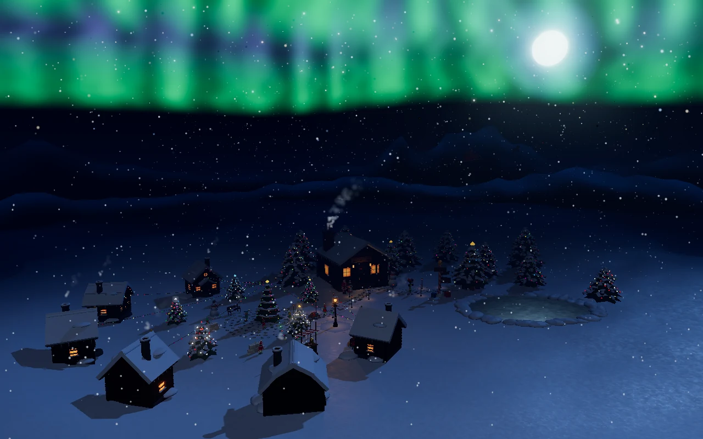

# North Pole on Christmas Eve

Three.js? Around here it's called Tree.js.

An interactive 3D night scene of the North Pole on Christmas Eve, running straight in your browser. Santa's workshop, a busy elf village, a frozen lake and northern lights across the whole sky. No 3D models, no image files and no build step: everything you see is made of shapes, procedural textures and custom shaders.

**[Open the live demo](https://wesley-dev-tech.github.io/noordpool-kerstavond/)**



## What's in the scene

- **The North Pole itself:** the red-and-white pole at 90° N, with signposts, presents and a mailbox that sends your wish up the chimney.
- **Santa's workshop:** a log cabin with glowing windows, a smoking chimney and a door that sends out an elf to deliver a present under the big Christmas tree.
- **The elf village:** six little houses around a village square, linked to the workshop by a stone path lined with lanterns. The elves lead their own lives: they have a snowball fight, chop wood, hang up lights, run a hot chocolate stand and pull a sleigh full of presents.
- **Santa and his reindeer:** flying across the sky, and they do a loop if you click them.
- **The sky:** 360° northern lights, twinkling stars, a moon with a halo and falling snow.
- **Sound:** wind, crackling fire and sleigh bells, all generated live with the Web Audio API.

The elves use obstacle avoidance, so nobody walks through Santa anymore. That wasn't always the case.

## Controls

| Action | What it does |
| --- | --- |
| Drag | Look around |
| Scroll | Zoom in and out |
| Click | Interact with almost anything: presents, trees, doors, the snowman, the sleigh, the elves |
| Double-click | Fly the camera to an object (Esc brings you back) |
| F | Show the FPS counter |
| D | Show the obstacle and collision circles |

The HUD also has buttons for the quality level (low, medium, high), sound on or off, and a flight to the elf village. The interface is in Dutch.

## Built with

- HTML, CSS and JavaScript (ES modules, no framework, no bundler)
- [Three.js](https://threejs.org/) r170, loaded through an import map
- Custom GLSL shaders for the northern lights, the stars and the snow
- Procedural `CanvasTexture` maps instead of image files
- Raycasting for clicks and hover effects
- Steering behaviours for the walking elves
- UnrealBloom post-processing and ACES filmic tone mapping
- Adaptive quality: the scene drops to a lower level when the frame rate falls below 50 fps

## Run it locally

ES modules don't load from `file://`, so serve the folder with any static web server:

```bash
git clone https://github.com/Wesley-dev-tech/noordpool-kerstavond.git
cd noordpool-kerstavond
python3 -m http.server 8000
```

Then open http://localhost:8000. Three.js comes from a CDN, so you need an internet connection.

## Project structure

```text
index.html        Entry point, import map, loading screen and HUD
style.css         Canvas, HUD and tooltip styling
src/
  main.js         Bootstrap and animation loop
  config.js       Shared coordinates, colours and quality profiles
  core/           Renderer, camera, lights and quality manager
  world/          Terrain, sky, northern lights, workshop, trees, path, elf village and more
  actors/         Santa and Mrs. Claus, the elves and their contact shadows
  ui/             HUD and procedural audio
  utils/          Noise, procedural textures and raycasting
```

## How it was made

The project was built step by step with AI coding assistants. The plan is in [PLAN.md](PLAN.md), every step is logged in [LOGBOEK.md](LOGBOEK.md), and the conversations are archived in [CONVERSATIES.md](CONVERSATIES.md) and the `conversaties` folder (all in Dutch).

## Author

Wesley Bogaerts, Full Stack & AI automation student at SyntraPXL.
See more of my work in my [portfolio](https://wesley-dev-tech.github.io/).
